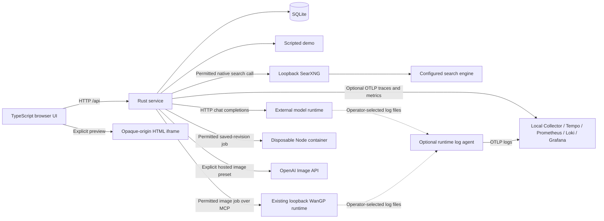

# Architecture

Implemented structure, not a description of a deployed GPU cluster.

| Module                                             | Responsibility and interface                                                                          | State authority                                                                                           |
| -------------------------------------------------- | ----------------------------------------------------------------------------------------------------- | --------------------------------------------------------------------------------------------------------- |
| `apps/web/src/App.tsx`                                                     | Workspace UI, backend/mode selection, run polling and proposal outcomes                               | Current workspace, selected version/draft, tab-memory editor drafts, unsent prompt, accepted receipts |
| `apps/web/src/WorkspaceLayout.tsx`, `workspace-layout.css`                 | Stable primary panes, resizable dividers, Preview hide/show, eight bounded floating tools and view navigation | Tab-memory presentation only; App and existing operation owners retain workspace/job authority            |
| `apps/web/src/Artifacts.tsx`                                               | Resolve shared version selection, floating Revisions, Source/Diff, review/settlement, export and capture | File/render-mode selection, rejection draft and immutable captured preview                              |
| `apps/web/src/ProjectEditor.tsx`                   | Edit/create/delete/restore files; Save for review and Ctrl/Cmd+S submit the same immutable manual input | In-flight action; draft text and submission identity belong to App                                        |
| `apps/web/src/CodeEditor.tsx`, `MonacoEditor.tsx`  | Lazy local source/diff surfaces, text fallback, model/observer disposal                               | Per-surface Monaco resources; shared language workers owned by Monaco                                     |
| `apps/web/src/editor-sanitizer.ts`                 | Private patched sanitizer for Monaco rich documentation                                               | Persistent resource-attribute policy across temporary-hook cleanup                                        |
| `apps/web/src/Executions.tsx`                      | Selected-script actions, run/explain continuation and one saved result card                           | Submission UUID, accepted receipts, pending explanation, owned polling/cancellation and history selection |
| `apps/web/src/ExecutionResultView.tsx`             | Plain-text frozen execution attachments                                                               | None; App owns the unsent result selection                                                                |
| `apps/web/src/ComputeResultCard.tsx`               | Temporary computation status, logs, SVG `` preview, downloads, asset review                      | Selected output asset IDs and in-flight asset proposal action; publishes proposal settlements to App      |
| `apps/web/src/ImageResultCard.tsx`                 | Saved image/progress display, download, scoped reconciliation and explicit unknown-outcome resolution | Owned display timer and action abort controller; App owns persisted job polling                           |
| `apps/web/src/ImageAttachments.tsx`                | Chat image selection and transcript thumbnails | App owns unsent IDs; saved run receipts own frozen attachment metadata |
| `apps/web/src/AssetLibrary.tsx`                    | Workspace text/image library, idempotent uploads and reviewed project bindings                        | Pending File/UUID and proposal input, local notices/errors and owned action controller                    |
| `apps/web/src/useDownloads.ts`                     | User-triggered Blob downloads                                                                         | Object URLs and revocation timers scoped to the owning surface                                            |
| `apps/web/src/RunActivity.tsx`                     | Per-run search/import/native evidence and validated saved source links                                | None; revision/compute permission and accepted receipts belong to App                                     |
| `apps/web/src/api.ts`                              | HTTP transport and validated wire/evidence types                                                      | None                                                                                                      |
| `apps/web/src/project.ts`                          | Portable source/asset namespace, candidate snapshots, binding diffs and bounded text diffs            | None; server remains authoritative                                                                        |
| `apps/web/src/preview.ts`                          | Prefix resource policy and encode a multi-file payload                                                | None; iframe sandbox supplies origin isolation                                                            |
| `apps/web/src/preview-project.js`                  | Resolve classic scripts/styles and static image references inside the opaque child                    | Child document only; no parent parsing of generated HTML                                                  |
| `crates/server/src/lib.rs`                         | API/static routing, bounded admission, run cancellation and execution                                 | Bounded run admission; shared per-group stage slots; cancellation tokens                                  |
| `crates/server/src/request_policy.rs`              | Local/configured demo authority and Origin validation for all routes                                  | None                                                                                                      |
| `crates/server/src/guests.rs`                      | Anonymous cookie initialization and closed HTTP resource ownership inventory                          | Request guest identity; never an operator role                                                            |
| `crates/server/src/store/guests.rs`                | Guest ownership/activity, scoped lists and transactional offline cleanup                              | SQLite guest credential digests and workspace ownership                                                   |
| `crates/server/src/store/model_calls.rs`           | Durable local dispatch, terminal-evidence settlement, safe per-run activity and offline operator inspection/resolution | SQLite owns call identity/exclusion; scoped live guards own transient stage observations |
| `crates/server/src/resources.rs`                   | Bounded FIFO stage acquisition and durable fence checks                                               | In-memory group slots shared by one leased Store                                                          |
| `crates/server/src/telemetry.rs`                   | Optional bounded OTLP export, explicit trace selection, metric vocabulary and periodic observation    | SDK worker queues and process-local instruments; no application state authority                           |
| `crates/server/src/store/telemetry.rs`             | Read-only parent/unresolved-ownership observation                                                     | SQLite remains authoritative; sampler writes no state                                                     |
| `crates/server/src/store.rs`                       | Transactional runs, drafts, messages, snapshots and proposal settlement                               | SQLite is authoritative for durable state                                                                 |
| `crates/server/src/store/migrations.rs`            | Atomic SQLite schema creation, version guard and v1–v23 upgrades                                      | Private startup connection until FK verification commits                                                  |
| `crates/server/src/store/assets.rs`                | Immutable workspace UTF-8 assets, input resolution and asset proposals                                | SQLite workspace asset ownership and `asset_ids` proposal provenance                                      |
| `crates/server/src/store/images.rs`                | Frozen reference metadata, durable job/remote ownership and atomic binary publication                 | SQLite image jobs/assets, active admission and operator resolution                                        |
| `crates/server/src/store/project_assets.rs`        | Project image ownership/budgets, pinned metadata and portable ZIP materialization                     | Reads immutable workspace images; no project execution or host writes                                     |
| `crates/server/src/store/context.rs`               | Project completed turns into model context with proposal outcomes                                     | Context is frozen transactionally when a run is admitted                                                  |
| `crates/server/src/store/workspace_files.rs`       | Native inventory/read/search/write/edit/delete/save tools, candidate validation and owned asset reads | Run-local candidate; Store::finish atomically publishes its automatic revision                            |
| `crates/server/src/store/edits.rs`                 | Validate manual edits, exact-base admission and idempotent receipts                                   | SQLite manual submission identity and immutable proposal                                                  |
| `crates/server/src/store/executions.rs`            | Immutable execution input binding, global admission, terminal receipts                                | SQLite job/worker ownership state and atomic output asset publication                                     |
| `crates/server/src/store/searches.rs`              | Search intent-before-I/O, result settlement, source IDs and pending closure                           | SQLite search permission and activity                                                                     |
| `crates/server/src/store/tool_executions.rs`       | Reserve/bind native executions (`run_node` / `compute_node`), close children                          | SQLite parent/scope/UUID/result ownership                                                                 |
| `crates/server/src/run.rs`                         | Load frozen context, compose requests, dispatch bounded search/import/Node/image calls                | Active loop messages, budgets and aggregated observations                                                 |
| `crates/server/src/prompt.rs`, `prompts/**`        | Resolve model/family/provider/default prompt fragments and compose context data                       | Compiled prompt hierarchy (`build.rs`); admitted run determines permission                                |
| `crates/server/src/demo.rs`                        | Scripted chat/HTML/file fixtures                                                                      | None; run orchestration owns progress and publication                                                     |
| `crates/server/src/url_import.rs`                  | Public-file URL/DNS policy, pinned HTTP transport and bounded text download                           | Transient HTTP requests; workspace assets own saved file/provenance                                       |
| `crates/server/src/search.rs`                      | Fixed SearXNG transport, query/provenance validation and bounded sources                              | Operator configuration, frozen privately with the run                                                     |
| `crates/server/src/images.rs`, `images/wangp.rs`   | Image profiles, owned job lifecycle, fixed MCP calls and bounded PNG/JPEG decoding                    | Live task ownership; persisted profile and remote receipt binding                                         |
| `crates/server/src/images/inventory.rs`, `apps/web/src/ImageInventory.tsx` | Operator-triggered WanGP model/adapter discovery and bounded normalized snapshots | In-memory browser snapshot; frozen preset catalog alone authorizes optional adapter selection |
| `crates/server/src/images/openai.rs`              | Direct OpenAI generation/editing, bounded inline references and terminal response validation | Images owns live credentials/tasks; Store owns intent, outcome and publication |
| `crates/server/src/sse.rs`                         | Shared bounded byte framing for model and MCP streams                                                 | Per-request decoder buffers                                                                               |
| `crates/server/src/worker.rs`                      | Fixed local Docker control, scoped recovery, budgets and cancellation                                 | Live task ownership; pinned daemon/image identity                                                         |
| `workers/node/runner.cjs`                          | Trusted PID 1 watchdog, materialize input and spawn nonroot Node                                      | Disposable container state; untrusted observed output                                                     |
| `workers/node/outputs.cjs`                         | Quiesce every project task, bounded regular UTF-8 output capture                                      | Trusted collector inside the disposable PID namespace                                                     |
| `tools/search/probe.mjs`                           | Standalone DDG/SearXNG/OpenAI search adapters; not called by app/models                               | Owned HTTP/browser resources; no durable application state                                                |
| `pinokio_agent/skills/api/wan-git/clients/mcp.mjs` | Standalone WanGP MCP discovery/call and verified image/MP4 downloads; not called by app/models       | Owned MCP session; caller retains request/job/context receipts                                            |
| `scripts/video-smoke.mjs` | Opt-in WanGP text-to-video preflight, one-job generation/cancellation and verified MP4 playback; outside the app | Append-only local request/job receipts and one exclusively created output |
| `deploy/search/`                                   | Optional loopback SearXNG with an explicit keyless Brave engine                                       | Separate container/cache/signing secret, independent of SQLite                                            |
| `crates/server/src/artifacts.rs`                   | Strict proposal parsing, portable paths, exact snapshot transformations                               | None; virtual paths never confer host access                                                              |
| `crates/server/src/model.rs`                       | Bounded text/native-call decoding, SSE framing and provider observations                              | External runtime owns weights, tokenization and GPU work; per-request decoder buffers                     |
| `crates/server/src/config.rs`                      | Validated named backends and process configuration                                                    | Default backend, model IDs, endpoints, credentials, limits                                                |
| `crates/server/src/routing.rs`                     | Validate model profiles/preferences and resolve explicit or Auto selection before admission          | Operator catalog; the accepted run owns the frozen route, backend and model                               |
| `crates/server/src/discovery.rs`, `apps/web/src/ModelInventory.tsx` | Bounded runtime inventory snapshots and owned manual refresh UI                                | External runtime observations; transient browser snapshots, no model residency authority                 |
| `crates/server/src/main.rs`                        | Process startup, HTTP tracing and graceful Ctrl+C / Unix SIGTERM shutdown                              | Listener and process lifetime                                                                             |

Local HTTP transport commits dispatch ownership and runs in an owned task that
survives parent cancellation. `store/model_calls.rs` owns durable group/target
fences, restart transitions and offline inspection/resolution. `resources.rs`
owns FIFO stage queues shared by Store clones. Model calls and owned image tasks
acquire separate slots. Configured independent groups execute concurrently.
See [local inference ownership](contracts/runtime.md#local-inference-ownership)
and the [remaining scheduling slices](plan/resource-scheduling.md).
Opt-in native recovery lives in `model/llamacpp.rs`: a live generated attempt
retains its group slot until native running/deferred gauges confirm idleness.
Generic transports and historical unresolved ownership retain offline recovery.

The same native Rust/Node build runs on Windows and Linux.
The [Arch/Linux guide](operations/linux.md) covers dependencies, native startup,
Docker socket ownership and private two-PC runtime connections. CI runs the
source tests on Ubuntu and rolling Arch. Unix signal tests cover SIGINT/SIGTERM
graceful exit and preservation of the saved data directory.
Live connector failures proven to precede HTTP transmission instead settle as
`resolved/request_not_sent`; the failed parent publishes nothing and releases
the group without a runtime probe. Protocol retries and redirects are disabled.

Optional telemetry selects explicit run/stage/job/recovery spans, preserves owned
task parentage and samples queue/ownership state. `main.rs` initializes exporters
on a blocking thread and owns sampling/shutdown. The [observability contract](contracts/observability.md)
defines privacy, signal meanings and failure isolation; the
[operator guide](operations/observability.md) owns local setup/evidence commands.
The optional `deploy/observability/runtime-logs.yaml` agent tails selected
external-runtime files separately from Deep's redacted telemetry. It owns only
file offsets, never application or runtime lifecycle state. The same config can
run beside a remote worker and send through a private tunnel.

## Request lifecycle

1. Submission validates input and resolves its named backend (or configured
   default) before reserving one of 16 total pending/active slots. Unknown
   backends fail before durable changes or model calls.
2. A SQLite transaction creates a server-issued run ID and its user message.
   Provider/model labels freeze the selected configuration on that receipt.
   Optional search permission freezes the configured SearXNG origin and engine.
   Optional script permission verifies and pins the revision explicitly supplied
   by the client. A changed head cannot silently substitute executable code.
   The same transaction saves projected model context and proposal decisions.
   File submissions also pin an explicit current base revision; app submissions
   automatically pin the current head. Stale file submissions insert nothing.
   A partial unique index allows one queued/running run per workspace.
3. HTTP returns `202` with that exact receipt. A background task waits for the
   first stage resource slot. The browser polls the workspace's persisted runs.
   The receipt immediately owns browser run tracking, even if the first detail
   read fails. Read retries never resubmit generation requests.
4. After acquiring its first slot, the task changes `queued` to `running`. It sends
   the saved model-context projection plus the current prompt to the selected adapter,
   including completed turns served by other backends. Model instances are built
   from independent configurations at startup and selected before enqueueing.
   App/file modes receive the pinned accepted snapshot after history and before
   the current prompt; it is authoritative over earlier unapplied proposals.
   Settled file-proposal replies are compact summaries; pending contents stay in
   context for revision requests, and raw replies remain in the transcript.
   Captured project state includes accepted revision identity,
   proposal outcomes and optional rejection reasons, including in Conversation
   mode. Later decisions cannot change queued/accepted input.
5. While chunks arrive, the worker saves best-effort draft/observation snapshots.
   Existing 500 ms polling displays those drafts and recovers them after reload.
   When tools are permitted, `run::complete` validates whole native batches,
   persists intents/results and returns observations to the same model. Intermediate
   text cannot publish a proposal. Only the final normal text response can finish.
   Only running runs accept progress. One transaction clears the draft and commits
   success, the complete assistant message, and any generated proposal.
   A cancelled run cannot later publish an assistant message or artifact.
6. Parent exit releases its admission permit. Owned stage slots remain held
   through completion/recovery. Restart marks
   unfinished persisted runs `interrupted`; it does not replay them.
   Every terminal transition closes pending search receipts while preserving
   completed sources. No search receipt can settle after terminal publication.
   Termination also marks an admitted linked worker job cancelling. Conditional
   worker admission prevents late starts. The owned background task signals and
   retains child cleanup independently of the parent response.

SQLite operations run on Tokio's blocking pool behind one connection mutex;
no connection lock spans model I/O. A data-directory file lease prevents two
Deep instances from sharing one database and interrupting each other's runs.
The standard-library file lock lives until the last `Store` clone is dropped.
One SQL predicate defines active runs for the unique index, admission,
cancellation and restart recovery.

Workspace deletion checks active model/Node jobs and active/unresolved image jobs in the same serialized
transaction, defers circular FK checks without disabling enforcement, deletes
workspace-owned history and commits atomically. Shared worker ownership remains.
App owns confirmation/retry and removes draft/selection only after success;
obsolete detail reads cannot restore the deleted selection.
Execution UUIDs alone survive in `execution_cleanup_ids`; the sweep recognizes
that ledger as well as current execution rows, retaining exact owner/daemon/path
checks. Retired IDs cannot launch new jobs. No chat/files/output/logs enter the ledger.
`store/branching.rs` owns chat turn deletion (`DELETE /api/workspaces/{id}/messages/{run_id}`)
and workspace branching (`POST /api/workspaces/{id}/branch`). Both require an idle
workspace (`409` while model, Node or image jobs are active). Deleting a chat turn
removes only its `messages` rows so subsequent `store/context.rs` projections omit
that turn, while preserving accepted `revisions`, `assets` and `proposals` (including
unapplied `pending` reviews). Branching clones accepted revisions, assets, executions
and all proposals with fresh remapped UUIDs into a new workspace while truncating
copied `messages` at optional `up_to_run_id`.

There is no automatic retry or cross-backend fallback. Demo, LM Studio, Groq,
OpenAI and a legacy compatible endpoint are named model backends. Search uses
their native function-call protocol when explicitly permitted. Model/image stages
acquire shared per-group slots; search/import/Node waits retain no GPU slot. Keys alone
do not enable a backend: an operator must name its model. Groq/OpenAI use fixed
official endpoints and separate keys. Status publishes only backend IDs and
configured model labels; those labels do not verify an upstream model revision.
The browser selects a backend explicitly and displays persisted reply provenance.
Responses request upstream SSE streaming. The decoder requires a normal finish
and `[DONE]`; truncated, malformed or incomplete streams cannot publish success.
A backend that returns JSON in the same request is supported without retrying.
Failed/cancelled/interrupted drafts remain plain, incomplete text and are excluded
from subsequent model history and revisions. Usage remains null when unavailable.
Provider-reported identity is distinct from the configured label. Persisted
timestamps supply queue/execution duration; a monotonic clock measures time to
first visible text delta. See the runtime contract for exact timing semantics.

`run::Backend` selects the scripted demo or HTTP adapter at startup. The demo
does not construct a model HTTP client. For real model calls, `prompt::messages`
combines embedded Markdown instructions, history and the accepted snapshot.
`run.rs` supplies native tool definitions and choices to `Model::complete`.
The adapter sends one request and decodes text/calls without selecting task
instructions or search policy. Rust still enforces permissions and publication.
The [runtime contract](contracts/runtime.md#request-composition) owns composition.

## Optional model tools

Real-backend browser requests use `chat` with `workspace_tools:true` by default.
The [workspace presentation](contracts/workspace-ui.md) has Chat, Editor and Preview
panes with one expand/restore control each. Stable portal hosts preserve their
instances while hidden or resized. Tab-memory split proportions resize adjacent
panes; hiding Preview gives its space to Editor. Chat has one pane scroll area
for replies and disclosed logs. Workspaces, Files & assets, Runs, Tools & attachments and Revisions
are bounded floating tools. Closing tools preserves operation owners; Stop preview
explicitly disposes its captured iframe. App owns shared workspace observations,
selected version (current/revision/proposal/draft), polling, request choices and drafts. Source/Diff
is an independent render mode; Revisions groups version navigation and Export groups
downloads. The captured Preview exposes its source separately from the accepted head;
Update preview explicitly captures the head without changing Editor selection. Resource actions
select saved IDs and reveal the relevant pane through a small navigation operation.
There is no selection-reference framework or persisted layout. The UI uses HTML/CSS;
the earlier optional desktop experiment is superseded.
Admission pins the accepted head. Native file tools expose a project inventory,
bounded reads, literal text search, exact unique edits, staged writes/deletions and
saved text/image asset placement. `run.rs` owns
the disposable candidate. Its successful final reply carries changes to
`Store::finish`, which atomically inserts an applied proposal and revision.
Unchanged candidates create no revision. Cancellation/failure discards staged
files while retaining assets already saved under their existing contracts.
Legacy app/files generation and manual proposals retain explicit settlement.
Schema v21 adds the frozen grant with false defaults for historical runs.

`run::complete` is the orchestration seam between admission and final publication.
It preserves the original single-call path when all capabilities are off. Frozen
permission controls `web_search`, `import_url` and the selected Node scope (`run_node` on a pinned
saved revision or `compute_node` with up to two temporary executions and selected/chained
workspace assets). Whole batches validate before effects. The runtime contract owns
shared budgets and deadlines. `model.rs` decodes the protocol. `search.rs` owns
SearXNG transport and source validation. `url_import.rs` owns bounded public-file
retrieval. `store/assets.rs` saves provenance and authorizes imports for same-run computation.
The [import contract](contracts/url-import.md) owns destination policy and publication deadlines. `store/searches.rs` owns durable searches.
Native calls reserve execution identities in `store/tool_executions.rs`, then use
the existing worker. The worker owns admission, isolation, cancellation and cleanup
for both saved-revision and temporary-code origins.

App owns per-request choices as uniform checkboxes under the **Request options**
group. **Change project files** enables the default-on native workspace file
capability on real backends (the scripted demo retains its legacy file format);
**Web access** grants configured search and public file imports. Imported text
assets retain source URLs and SHA-256 in the workspace library. **Analyze files
and create outputs** enables computation with selected workspace input assets without
sending asset bytes in model context. **Image generation** enables a profile
whose selection and reference image live in its expanded panel. These
capabilities compose independently. Configured computation and image tools default
on, and successful sends reset web permission and selected inputs. `api.ts` validates permission, exact
native result binding and saved activity before publication. `RunActivity` renders activity and source links
from receipts, while model citations remain plain text. `ComputeResultCard` renders
temporary computation status, logs, restricted SVG `` previews, file downloads
and explicit **Review selected files in project** proposals (`POST /api/workspaces/{id}/asset-proposals`).
Successful prior search and native observations enter later frozen context through
`store/context.rs` without granting further permission. The [runtime contract](contracts/runtime.md#model-tools)
owns the loop. Search and execution contracts own transport and worker guarantees.
Project execution polling covers the gap between intent and admission. Observed
native IDs also refresh the result card if a whole run finishes between UI polls.

An image profile enables `generate_image` alongside the other granted tools.
Its optional LoRA catalog freezes at admission. `images.rs` validates selected
catalog IDs and composes configured strengths over fixed preset adapters;
`store/images.rs` persists exact job settings and derives public applied-adapter
receipts independently of current configuration. Operator-triggered WanGP
inventory uses fixed MCP reads, bounded normalized pages and tab-memory snapshots.
It cannot register adapters, load weights or grant tool authority.
`images.rs` retains task ownership across parent cancellation and MCP receipt
binding. `images/wangp.rs` calls the existing runtime without starting inference
processes or exposing its full toolset to the model. `store/images.rs` owns frozen
inputs, uncertain states, advisory progress/contact snapshots and binary publication.
Admission pins an optional same-workspace reference image ID and role. The owned
task verifies and uploads its bytes through a same-origin grant before conditional
dispatch. WanGP receives one main-scene reference. Model requests contain metadata
only. Runs/jobs retain input provenance independently of the resulting asset.
`ImageResultCard` displays validated saved evidence and owns its elapsed/freshness
timer. App continues polling image cleanup after a parent ends. Correlated tracing
spans follow runs, model rounds/calls and independently owned image communication.
The [image contract](contracts/images.md) owns budgets, transfer/decoder limits
and explicit reconciliation. `scripts/image-smoke.mjs` verifies the real browser,
selected text backend, WanGP, downloaded bytes and reload, with an opt-in
scoped cancellation mode.

The separate [video runtime probe](operations/video-probe.md) reuses the standalone
MCP client for bounded text-to-video work. Its synced JSONL records retain exact
settings, dispatch intent and job identity. It checks final-task binding, MP4
integrity and Chromium playback. It has no application route, model tool, SQLite
asset, project binding or access to Deep's resource scheduler.

## Artifacts and execution

Revisions contain immutable full text-file snapshots. Legacy app/files generation formats
publish pending proposals. The API's app mode adapts a complete `html` fence into
one `index.html` write. File mode parses strict write/delete JSON. `Store::finish`
normalizes both formats before shared base validation and atomic publication.
The UI offers Conversation and Change project files, defaulting to the latter.
Applying a proposal atomically checks the current base and absence of active
workspace work, inserts a snapshot and records its revision ID. Repeat application
returns the same revision. Rejection is durable; stale changes require regeneration.
See the [artifact contract](contracts/artifacts.md) for limits and exact behavior.

Manual editing starts from accepted files or clones a nonstale pending candidate.
App owns drafts by workspace in tab memory, above disposable Monaco views. Leaving
a dirty tab prompts; switching workspaces preserves text. Save captures a UUID and
exact changes before sending; a lost response retries the same submission rather
than creating another proposal. `store/edits.rs` checks matching receipts before
current-head admission and validates the full candidate in its transaction. A
saved manual proposal uses the same explicit review/apply/reject operations. Draft
contents never become accepted model input or executable Node input implicitly.
Monaco and workers are local lazy assets with a text fallback. Its embedded
sanitizer import is aliased to a private patched DOMPurify instance; permanent
resource stripping survives Monaco's temporary-hook cleanup. JSON schema fetches
are disabled. Source/diff view selection does not run project code.

The artifact panel offers source, image-binding diffs, bounded text diffs, file/manifest/ZIP download and
candidate preview. Shared workspace state owns accepted settlement receipts so
chat outcomes and file review agree through failed refreshes; workspace-owned
lifetimes abort obsolete requests. Rejection can carry a bounded immutable reason
without creating work, changing files or rewinding chat. The composer exposes
what the next request includes. The model
receives accepted files, not whichever revision the browser is viewing. There
is no model-controlled host write. Revision/proposal selection never executes
code. **Run preview** creates an iframe with `sandbox="allow-scripts"`
and no same-origin permission. A prefixed CSP blocks ordinary external resources,
fetches and form submissions. The application does not accept messages or tool
requests from generated frames.

One selection identifies current files, a historical revision or a proposal.
The file list shows the complete candidate, including unchanged and deleted paths,
in source, diff and preview. New proposals select review without interrupting an
editor draft or active preview. History and optional rejection feedback use
disclosure controls. A selected script exposes Run script/Check syntax beside its
path. Other files expose a collapsed script picker. One execution module stays
mounted across those controls, with the saved result card visible independently.
Project preview chooses an HTML entry independently of the selected source file.

The workspace library presents text assets and uploaded/generated PNG/JPEG images.
Manual proposals bind immutable image IDs at relative project paths. Revisions
retain complete binding snapshots independently of source text. Project bindings
supply metadata. Explicit [chat image attachments](contracts/vision.md) separately
supply pixels to vision models for the current run and its tool continuations.
Saved context retains metadata. Binary images are not Node inputs.
`store/project_assets.rs` validates the combined namespace and exports
selected snapshot bytes as a ZIP. The [asset contract](contracts/assets.md) owns
binding, input and materialization guarantees.

Multi-file preparation encodes the selected source snapshot and captured image
data URLs as escaped render-only JSON; only the child parses generated HTML and
resolves scripts/styles/images. Parent-origin blob URLs are not used in the opaque
frame. These render bytes never enter project source or model requests. CSP precedes
that parse and the final document. Modules/packages and full server semantics
remain unsupported. Preview captures specific content until another explicit run.

The sandbox protects parent DOM/storage. It does not provide CPU/memory quotas
or a complete network isolation guarantee. Downloads include text, manifests and ZIP bundles;
opening one outside Deep does not retain the preview's isolation policy.
Native execution is a separate explicit capability described below.

## Node worker

The [execution contract](contracts/execution.md) defines fixed check/run actions
against an immutable saved revision. It is opt-in through `DEEP_WORKER_IMAGE`;
images are built separately and never pulled implicitly. The native application
controls a local Linux Docker engine through argument-based CLI calls with bounded
I/O/time. Every job pins the resolved image ID. No generated text is interpolated
into a host shell; no host project/data, credentials or Docker socket enter the
container. A permitted `run_node` call uses this same worker without installing dependencies.
Native workspace computation stages captured outputs for automatic publication.
Legacy execution outputs retain explicit proposal review/application.

The first binding freezes endpoint, daemon ID and canonical database path in
SQLite. Docker context changes cannot redirect operations; a copied/moved bound
database cannot sweep the original. The supervisor is namespace PID 1 with only
SETUID/SETGID/KILL capabilities; generated Node runs as uid/gid 65534 without effective
capabilities. A supervisor timer ends the namespace after 15 seconds independently
of the app. Docker enforces no external network, read-only root, bounded tmpfs,
memory/swap, CPU and PIDs. The app adds a host deadline, bounded output and scoped
whole-container cleanup. Results remain untrusted observations.

A submission UUID binds exact workspace/revision/entry/action; matching retries
return the same receipt. One execution is admitted globally, independently of
model generation. Cleanup precedes terminal settlement of possibly started work;
settlement and live-task bookkeeping share the worker mutex so recovery cannot
sweep a newly admitted live task. Failed cleanup retains nonterminal state and
blocks admission. On startup, cleanup runs even with the image disabled/missing;
recovery interrupts unfinished jobs without replay. An uncertain create is never
started but can leave stopped residue for a scoped sweep; its receipt warns about
that narrower guarantee. Model-run cancellation retains its existing semantics.

After direct-child exit, PID 1 kills remaining descendants and establishes task-level
quiescence before collecting `/output` and optional `/work/output`. Missing task enumeration for a still
present group fails capture; zombie leaders are not proof of thread termination.
No-follow handles, file-type/link/UTF-8 checks, portable paths and bounded traversal
produce at most 64 files/1 MiB across both roots. Root links and duplicate mapped
paths fail capture. Separate `/work` and `/output` tmpfs mounts have
16 MiB limits. Rust revalidates the 8 MiB-bounded protocol; successful cleanup alone
permits eligible captured files to be persisted. Job lists expose summaries only.

Output review creates one idempotent proposal per execution. Output, model and
manual proposals/revisions carry exactly one nullable source ID (`execution_id`,
`run_id` or `edit_id`), with no synthetic model work. All use the same immutable snapshot and
stale-base application operations. New output is writes only, preserves omitted
files and must fit the merged project budget. The browser owns accepted proposal
receipts across failed refreshes, withholding candidate views when the exact base
has not loaded. The demo offers a fixed `build.cjs` output generator for this flow.
The normal starter generates actual project files. Execution receives only a saved revision, including the exact revision
created by an applied proposal; pending/rejected candidates supply no executable
input. HTML-only revisions show explicit guidance instead of an empty entry picker.

The execution panel owns live results, logs and the pending Run and explain intent.
That intent binds the selected manual job and backend callback. Terminal observation
consumes the intent once. App submits the saved-result explanation without tool
permission. Explain result skips execution. Both actions preserve the composer draft.
Workspace disposal and Stop clear the pending continuation. App separately owns an
unsent result selection for Ask AI to fix, clears it on workspace changes and preserves it on failed
submission. Fix drafting selects file mode without sending or changing backends.
Admission resolves `execution_result_id`; `store/executions.rs` projects the
observation and `Store::begin` saves it with that run's context transaction.
`store/context.rs` includes attached observations from successful prior turns.
The execution contract owns [explanations](contracts/execution.md#script-explanations)
and [result attachment/repair semantics](contracts/execution.md#conversation-results-and-repair-requests).

## Configuration and verification

Run from the repository root. `.env` supplies defaults without replacing process
environment variables. The native API defaults to loopback port 4318; the container
keeps internal/published port 4317. Browser tests use 14318/14319. Vite proxies to
`DEEP_BIND`, or `DEEP_DEV_API_URL` when explicitly set. A production web build is
served by Rust from `DEEP_WEB_DIR`. `/api/status` describes configuration and
does not claim that a remote model is healthy.

The application router owns both API routes and static fallback. Its outer
request policy accepts exact `localhost` or literal loopback IP authorities.
An optional `DEEP_PUBLIC_ORIGIN` also accepts one exact HTTPS origin and enables
anonymous browser guests. Guest initialization runs under a browser Web Lock
before workspace loading. Guest workspace mutations wait for that initial load.
The guest middleware resolves resource ownership before every API handler.
The [guest contract](contracts/runtime.md#private-browser-guests) owns access and
cleanup behavior. The [demo guide](operations/demo.md) owns sharing and commands.
When an Origin is supplied, the policy requires HTTP(S) with a matching host and
effective port. Opaque/foreign origins and unconfigured hosts receive JSON `403`
before handlers run. The policy ignores forwarding headers and performs no DNS
lookup. Vite preserves its frontend Host, so local proxy traffic remains valid.
Wildcard container binding does not expand the accepted authorities. This policy
mitigates DNS rebinding, not malicious local processes or unauthenticated LAN use.

Default data is `data/deep.sqlite3` with SQLite WAL files and an adjacent lease
file. Stop the service before copying that directory for a simple backup.
SQLite schema version 22 adds frozen model-profile routing provenance. Historical
runs have no route. Version 21 adds the frozen native workspace-tool grant. Historical
runs default to false and retain their original proposal behavior.
Version 20 removed the global image-admission index so planned jobs
can share the resource queue. Group/runtime dispatch guards remain authoritative.
Version 19 added durable local model-call ownership.
Version 18 added frozen URL-import permission and asset source provenance.
Version 17 added nullable frozen reference-image metadata on runs.
Version 16 added guest credential digests, activity and workspace ownership.
Version 15 adds image progress/contact observations.
Version 14 adds image upload provenance/name and immutable project
asset bindings. Version 13 added private frozen image configuration, durable
`image_jobs` and separate BLOB-backed `image_assets`. Version 12 added workspace-owned UTF-8 `assets`, temporary `compute_node`
executions, `runs.node_scope` / `runs.input_assets`, ordered multi-call `run_executions`
and `asset_ids` proposal/revision provenance after version 11's revision-bound execution
permission, version 10's search activity, version 9's result attachments, version 8's
cleanup identities, version 7's manual edits, version 6's context and version 5's outputs.
Opening version 1, 2, 3, 4, 5, 6, 7, 8, 9, 10, 11, 12, 13, 14, 15, 16, 17, 18 or 19
commits all pending upgrades in one transaction,
backfilling old HTML as `index.html`. Existing messages/revisions/observations
survive; old missing observations remain unknown. Recovery runs only after the migration commits. Unknown newer
versions are rejected before schema mutation or recovery. A port bind failure
also occurs before opening or migrating the data directory.
The private startup connection temporarily disables FK enforcement for SQLite's
create-copy-drop-rename procedure, checks all foreign keys before commit, then
reenables enforcement before recovery. Existing IDs/row order/content and
base/application/execution links are preserved; failures roll back all upgrades.
Dependency resolutions live in Cargo.lock and package-lock.json.
Rust 1.89 is the checked minimum, including standard-library file locking.
CI audits Rust advisories on changes and weekly with warnings treated as failures.
Dependabot monitors Cargo, npm and GitHub Actions dependencies.

Use [README verification](../README.md#build-and-verify). Rust tests cover HTTP
receipts, workspace conflicts, 16-slot admission, serialized execution,
cancellation, late completion, failed-turn exclusion, durability, complete HTML
extraction and adapter request serialization/authentication. Browser checks
exercise run recovery and Stop, UTF-8 prompt boundaries, revision retention,
real JavaScript execution, blocked parent/storage access and CSP rejection of
parser-inserted external scripts, styles and images.
Proposal checks cover exact untouched text/deletions across restart, generation
and application base conflicts, idempotent settlement, migration rollback, diff
review, apply receipts after failed refresh, and obsolete action disposal.
Authority regressions exercise API/static denial, real IPv6/wildcard listeners
and browser traffic through Vite's local proxy. Worker verification covers durable
idempotency, migration rollback, UI transport loss/reload/disposal, real container
resource/credential/filesystem/network controls, cancellation, watchdog timeout,
copied-path refusal and disabled-worker recovery. See the
[execution verification record](reviews/execution-smoke-2026-10-29.md).
The [output verification record](reviews/output-smoke-2026-10-30.md) adds provenance
migration, filesystem rejection, worst-case transport and real UI handoff checks.
The [generator UX check](reviews/generator-ux-2026-10-30.md) covers HTML-only entry
guidance, applied proposal execution and a live OpenAI generator/output preview.
The [proposal feedback check](reviews/proposal-feedback-2026-10-30.md) covers saved
reasons, frozen context, raw transcript preservation, migration rollback and live
model acknowledgement of a rejection.
The [editor verification record](reviews/editor-smoke-2026-10-30.md) covers manual
provenance, save/reload/ownership recovery, locally served editor assets, hover
resource blocking and the real manual-generator/worker-output/preview flow.
The [workflow check](reviews/workflow-consolidation-2026-10-30.md) covers shared
HTML/JSON proposal publication and the live multi-file create/change/preview flow.
The [search run check](reviews/search-run-smoke-2026-10-30.md) covers native JSON/SSE
calls, budgets, cancellation/restart, migration rollback, source validation and a
live gpt-5.4-mini/SearXNG conversation.
The [prompt/execution check](reviews/prompt-execution-2026-10-30.md) covers composed
requests, selected-script actions, durable result cards and real script/output
execution after separating prompt policy from model transport.
The [native execution check](reviews/node-tools-2026-10-30.md) covers linked
ownership/cancellation, combined tools, revision-bound consent, delayed admission
and a real model/worker failure, reviewed repair and verification.
These checks do not establish backend GPU cancellation or model quality.
The opt-in `scripts/eval-workspace.mjs` checks saved text-file task outcomes,
revision preservation and publication provenance against an explicitly selected
local model profile. [Task cases](../evals/cases/README.md) define its checks and limits.
The [file-tool verification record](reviews/workspace-file-tools-2026-11-02.md)
separates fixture coverage from unsuccessful live Saluki attempts.
The opt-in `scripts/smoke.py` uses synthetic chat/app/file requests against a running
server and an isolated data directory. It checks arithmetic and proposal binding,
not generated-code correctness. See the [delivery plan](plan/plan.md) for subsequent
work, [initial live observations](reviews/backend-smoke-2026-10-29.md), and
[streaming observations](reviews/streaming-smoke-2026-10-29.md).
The [file verification record](reviews/files-smoke-2026-10-29.md) distinguishes
valid proposal parsing from actual generated-app preview behavior.

The browser validates JSON shapes before publishing state. Workspace fetches
have cancellation and generation guards so old responses cannot replace a newer
selection. Poll timers stop when their run/workspace owner changes.
Obsolete refreshes cannot abort the selected workspace's request. Status and
workspace-list reads load independently; failed initial reads retry with timers
owned by their effect.
