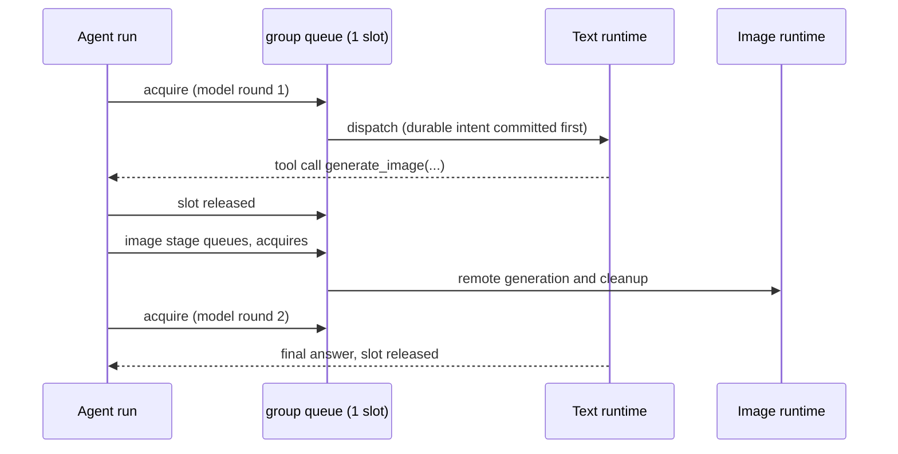

# Scheduling, queues and durable ownership

A human-facing explanation of how Deep decides *when* work runs. It covers the
admission gate, resource groups, stage queues, and the durable ownership records
that survive cancellation and restart. This document explains; it does not own
the guarantees. The authoritative sources are
[`architecture.md`](../architecture.md) (module map and request lifecycle) and
the [runtime contract](../contracts/runtime.md#local-inference-ownership)
(ownership, recovery and stage-scheduling guarantees).

## One control plane, four limits

Deep is a chat interface attached to a model server, but the server side is also
a small resource scheduler. Requests pass through limits applied at different
stages — they are not five worker pools, and a request occupies each limit only
while it is inside that stage:

| Limit | Capacity | What it protects |
| :--- | :--- | :--- |
| Global run admission | 16 pending + active parent runs | Bounds how much work Deep accepts at all |
| Each resource group | 1 active stage, at most 16 FIFO waiters | Keeps conflicting inference workloads off one runtime/GPU |
| Each workspace | 1 queued/running run | Prevents concurrent model runs editing one workspace |
| Node executor | 1 active execution globally | Isolates container execution capacity |

A queued run counts toward the global 16 while it waits for `local-gpu`; it does
not occupy the GPU slot until one of its stages acquires that slot. The scripted
demo backend uses no resource slot at all and starts immediately after admission.

## Resource groups

A resource group is a named set of operations that must not execute
simultaneously. Each group is one Tokio semaphore permit plus a bounded FIFO
waiter queue ([resources.rs](../../crates/server/src/resources.rs)). If a text
model and an image runtime share one GPU, assign both to the same group and Deep
serializes them; groups are logical labels, not hardware detection. The
operator must map aliases of one runtime (or one shared GPU) to the same group —
Deep does not discover physical GPU placement.

Defaults and their per-backend overrides:

| Backend/profile | Default group | Override |
| :--- | :--- | :--- |
| `compatible` / llama-server | `local-gpu` | `DEEP_MODEL_RESOURCE_GROUP` |
| `lmstudio` | `local-gpu` | `DEEP_LMSTUDIO_RESOURCE_GROUP` |
| `openai` text | `openai` | `DEEP_OPENAI_RESOURCE_GROUP` |
| `groq` text | `groq` | `DEEP_GROQ_RESOURCE_GROUP` |
| WanGP image profile | `local-gpu` | `resource_group` in the profile JSON |
| OpenAI image profile | `openai-images` | `resource_group` in the profile JSON |

Hosted groups (`openai`, `groq`, `openai-images`) count active HTTP requests;
they protect rate limits and politeness, not a GPU. Group names are
operator-owned, case-sensitive identifiers of 1–64 ASCII letters, digits, dots,
underscores or hyphens. When every waiter slot in a group is taken, further
stages are rejected with "Resource queue is full" rather than growing the queue.

## Stages, not conversations

Deep schedules *stages*. A model call acquires its group slot, runs, settles its
completion evidence, and releases the slot; the next stage joins the back of the
queue as a fresh waiter. Three properties follow:

- **One turn's slot never covers the whole run.** An agent loop re-acquires the
  slot for every model round. Search, URL imports and Node execution never hold
  a GPU slot.
- **Fairness is by stage arrival, not parent submission.** Image and text stages
  have equal priority in the same FIFO queue, across all workspaces and browser
  sessions. A long image job can legitimately delay short text requests that
  arrived later — and a long-running agent gets no priority just because its
  first stage started earlier.
- **The LLM → image → LLM sequence cannot deadlock.** Because a stage never
  acquires a second slot while retaining the first, an agent that generates an
  image with a tool call acquires the shared group three separate times:

If instead a run held `local-gpu` for its whole lifetime, an image tool bound to
the same group could never start — the run would wait for a slot it already
owned.

## Durable ownership: why a semaphore is not enough

An HTTP timeout does not prove upstream inference stopped. A naive
acquire/send/release design would let Deep hand the GPU to the next request
while the previous generation is still running. Deep therefore persists a
`model_calls` record in SQLite *before* every local model dispatch
([store/model_calls.rs](../../crates/server/src/store/model_calls.rs)); owned
image jobs keep their own equivalent records. The record freezes the run,
round, resource group, backend/model and runtime URL, then follows one path:

- `dispatching` → `completed` when terminal evidence arrives (an SSE `[DONE]`
  marker or a complete response body — even if the answer itself later fails
  validation).
- `dispatching` → `resolved/request_not_sent` when a connection-setup failure
  proves the request never left.
- `dispatching` → `unresolved` for transport errors, timeouts or process loss
  without proof either way. On restart, leftover `dispatching` records become
  `unresolved`; unfinished runs become `interrupted`. Nothing replays.

An unresolved record fences its group: new conflicting stages are rejected
until the record is settled. The fence matches **either** the frozen group or
the identical frozen runtime URL, so renaming a resource group cannot bypass an
unresolved runtime. Two recovery paths settle uncertainty:

1. **Native llama-server recovery** (`DEEP_MODEL_RUNTIME=llamacpp` with a
   standalone server started with `--metrics`): the owned cleanup task keeps the
   group slot and polls `/metrics`, requiring both `requests_processing` and
   `requests_deferred` to be zero in two successive samples. Confirmation marks
   the call `resolved/runtime_confirmed_idle` and releases the slot; a failed
   probe leaves it unresolved.
2. **Offline operator resolution**: stop Deep, verify the runtime is idle, then
   `deep-server model-calls --resolve <id> --confirm-idle`. No HTTP route
   exposes inspection or resolution.

This is deliberate safety over availability: if completion is uncertain, the
resource stays fenced even though the user already saw the run fail. Active or
unresolved ownership also blocks workspace deletion, chat-turn deletion and
branching. The boundary is explicit: Deep coordinates only operations it
dispatched from this process and data directory. A person using LM Studio
directly, or a second Deep installation with its own database, bypasses this
coordination.

## Telling "waiting" from "blocked"

A queue position is healthy; a fence is an incident. Workspace reads expose a
per-run `local_model` phase that distinguishes them:
`waiting` (acquiring a slot), `working` (dispatch intent + live transport),
`draining` (parent gone, transport still cleaning up), `recovering` (native
idle-confirmation live), `blocked` (unresolved ownership, operator action
required) and `settled`. See the
[activity table](../contracts/runtime.md#public-local-model-activity) in the
runtime contract for exact evidence per phase.

## What SQLite coordinates

SQLite is more than a filesystem here; it is the coordination database that
makes the guarantees above survive crashes ([store.rs](../../crates/server/src/store.rs)):

- **Atomic publication** — a successful run commits its final assistant reply,
  accepted project changes and immutable revision in one transaction. A failed
  or cancelled run cannot publish late changes after becoming terminal.
- **Frozen context** — the model receives the context assembled when the run was
  admitted. Later workspace edits cannot silently rewrite an accepted request.
- **Restart recovery** — unfinished runs are marked `interrupted`, dispatch
  intents become `unresolved`, and image jobs with remote identities have their
  own reconciliation path. Recovery never re-sends inference.

The split between memory and disk is deliberate: Tokio semaphores, queue
positions and live stage observations are transient; accepted changes, run
receipts and uncertain external ownership are durable.

## Other subsystems worth knowing

| System | What it does |
| :--- | :--- |
| Model routing | Resolves an explicit profile or Auto preference *before* admission; the accepted run freezes the route. No benchmarking, VRAM math or weight management. |
| Native tool orchestrator | Frozen per-run permissions and budgets (bounded file-tool writes, 2 searches, 2 imports, 2 computations, one image job, bounded model rounds). The model cannot grant itself capabilities. |
| Docker execution supervisor | Runs Node scripts in a disposable container with no network, bounded CPU/memory/tmpfs/PIDs and a watchdog; results are untrusted observations. |
| Immutable revisions | Accepted snapshots and proposal history are preserved and traceable; repeat application is idempotent. |
| Image job state machine | Durable planning → submission → execution → cancellation/reconciliation, so a lost response is never treated as a clean cancel. |
| Observability | `resource.wait` spans with `group_wait_ms` and `acquired`/`queue_full`/`ownership_blocked` outcomes, periodic samples of slot/queue/ownership state, and the run phases above. See the [operator guide](../operations/observability.md). |

## Limits operators should expect

- **Deep coordinates timing, not VRAM.** Nothing unloads a model or clears GPU
  memory when work switches between LM Studio and WanGP, or between backends.
  The same backend keeping its weights resident between requests is the
  runtime's own behavior, as is WanGP retaining cache after a job. `settled`
  ownership means Deep's record is complete — resident model weights may still
  exist.
- **No priorities or workload classes.** Every stage in a group shares one FIFO
  queue with equal priority. If measurements ever show short requests starving
  behind long image jobs, fairness policy is a future change, not a current
  knob.
- **Coordination is per data directory.** Other clients of the same runtime, or
  a second Deep instance on another database, are outside the scheduler. The
  file lease prevents two instances from sharing one database, nothing more.

For incident handling around uncertain ownership, see the
[GPU handoff runbook](../operations/gpu-handoff.md). For the full module map and
request lifecycle, see [`architecture.md`](../architecture.md).
